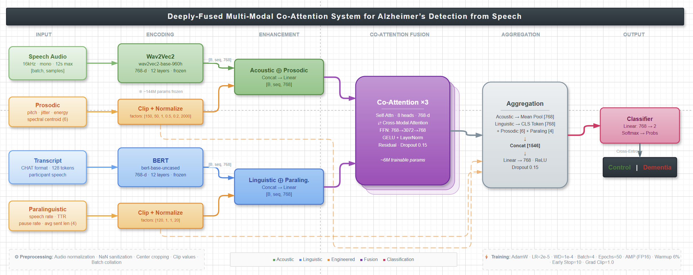
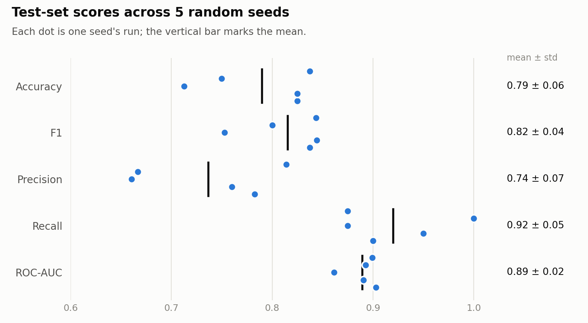

# Deeply-Fused Multi-Modal Co-Attention (AD from Speech)

A multimodal deep-learning pipeline for detecting Alzheimer's disease and dementia from spontaneous speech. It fuses acoustic embeddings (Wav2Vec2), transcript embeddings (BERT) and hand-crafted prosodic/paralinguistic features through stacked co-attention layers, and classifies each speaker as **Control (0)** or **Dementia (1)**.

---

## Architecture



1. **Acoustic stream** — Wav2Vec2 (`facebook/wav2vec2-base-960h`) embeddings from the raw audio, fused with 6 prosodic features extracted with librosa (pitch mean/std, jitter, energy mean/std, spectral centroid).
2. **Linguistic stream** — BERT (`bert-base-uncased`) embeddings from the transcript, fused with 4 paralinguistic features extracted with spaCy (word count, type-token ratio, pause rate, average sentence length).
3. **Fusion** — a Transformer encoder layer per stream, then 3 stacked co-attention layers in which text attends to audio and audio attends to text.
4. **Classifier** — pooled representations of both streams are concatenated and passed to an MLP.

The pretrained backbones start frozen; the last 4 layers of each are unfrozen from epoch 3.

---

## Repository Layout

- `scriptsUpdates/` — current pipeline
  - `enhanced_config.py` — paths and hyperparameters
  - `enhanced_preprocess.py` — parses DementiaBank CHAT (`.cha`) transcripts and builds the metadata CSV
  - `process2_preprocess.py` — builds the metadata CSV for the PROCESS-2 corpus
  - `enhanced_dataset.py` — dataset, audio loading and cached hand-crafted feature extraction
  - `enhanced_model.py` — fusion + co-attention model
  - `enhanced_train.py` — 10-fold cross-validation training
  - `enhanced_results.py` — aggregated metrics, confusion matrix and training-curve plots
  - `summarize_seeds.py` — combines runs with different seeds into mean ± std test metrics and a chart
- `results/` — per-seed test metrics (`seed_runs/`, `seed_summary.csv`) and charts (`plots/`)
- `scripts/` — original baseline (Wav2Vec2 + BERT co-attention only, single train/validation split)
- `architecture.png`, `architecture-code.xml` — architecture diagram (draw.io source)

---

## Setup

```bash
python -m venv .venv
source .venv/bin/activate        # Windows: .\.venv\Scripts\Activate.ps1
pip install -r requirements.txt
python -m spacy download en_core_web_sm
```

A CUDA GPU is strongly recommended (e.g. a free Kaggle or Google Colab T4). Training uses mixed precision automatically when CUDA is available.

---

## Data

The data is **not included** in this repository. Do not commit or redistribute it. Two corpora are supported:

### PROCESS-2

[PROCESS-2](https://huggingface.co/datasets/CognoSpeak/PROCESS-2) (gated; request access on Hugging Face) contains English recordings and transcripts from 400 participants (healthy, MCI, dementia) with a predefined train/test split. Download it to `data/process2/` and build the metadata:

```bash
cd scriptsUpdates
python process2_preprocess.py                       # Cookie Theft task; healthy vs MCI+dementia
python process2_preprocess.py --labels dementia     # healthy vs dementia only
python process2_preprocess.py --tasks CTD PFT SFT   # include the fluency tasks
```

With `USE_OFFICIAL_SPLIT = True` (default), training uses the dataset's own train/test split.

### DementiaBank Pitt

The [DementiaBank](https://talkbank.org/dementia/) Pitt corpus (Cookie Theft picture description) requires DementiaBank membership. Expected layout (audio may be `.wav` or `.mp3`; transcripts share the audio file's name):

```
data/pitt/control/audio/*.wav         data/pitt/control/transcripts/*.cha
data/pitt/dementia/audio/*.wav        data/pitt/dementia/transcripts/*.cha
```

---

## Usage

Run the scripts from `scriptsUpdates/` (paths in `enhanced_config.py` are relative to it):

```bash
cd scriptsUpdates
python enhanced_preprocess.py   # Pitt; or process2_preprocess.py for PROCESS-2
python enhanced_train.py        # writes ../results and ../models
python enhanced_results.py      # summary report and plots in ../results
```

To measure run-to-run variation, train with several seeds and combine them:

```bash
for seed in 42 1 2 3 4; do python enhanced_train.py --seed $seed; done
python summarize_seeds.py       # per-seed table, mean ± std and a chart in ../results
```

### Evaluation protocol

- PROCESS-2: the official train/test split, with a validation set held out from the training participants.
- Otherwise: 10-fold cross-validation; within each fold the remaining data is split 8 : 1 into train and validation.
- Splits are **stratified** by label and **grouped by speaker**, so recordings from the same participant never appear in both training and test data.
- Prosodic/paralinguistic features are standardized using statistics from the training split only.
- The checkpoint with the best validation F1 is evaluated on the held-out test fold.

### Training details

AdamW (1e-5 for the pretrained backbones, 1e-4 for the new layers), cosine schedule with warmup, class-weighted cross-entropy with label smoothing, gradient clipping and early stopping (patience 5).

---

## Results

**PROCESS-2, official train/test split.** Healthy controls (0) vs. cognitively impaired, MCI or dementia (1); Cookie Theft recordings only; 400 participants (200 / 200), 80 of them in the official test set. Five training runs on a Kaggle T4 with seeds 42, 1, 2, 3 and 4. The seed changes weight initialization, batch order and which ~36 training participants are held out for validation; the test set is the same in every run. Each run evaluates its best-validation-F1 checkpoint once on the test set.

| Metric | Mean ± std over 5 seeds | Range |
|---|---|---|
| Accuracy | 79.0% ± 5.5% | 71.3–83.8% |
| F1 | 0.816 ± 0.040 | 0.753–0.844 |
| Precision | 0.737 ± 0.070 | 0.660–0.814 |
| Recall | 0.920 ± 0.054 | 0.875–1.000 |
| ROC-AUC | 0.889 ± 0.016 | 0.862–0.903 |

<picture>
  <source media="(prefers-color-scheme: dark)" srcset="results/plots/seed_metrics_dark.png">
  
</picture>

| Seed | Accuracy | F1 | Precision | Recall | ROC-AUC | Best epoch |
|---|---|---|---|---|---|---|
| 42 | 0.838 | 0.843 | 0.814 | 0.875 | 0.899 | 2 |
| 1 | 0.825 | 0.837 | 0.783 | 0.900 | 0.903 | 3 |
| 2 | 0.825 | 0.844 | 0.760 | 0.950 | 0.891 | 4 |
| 3 | 0.713 | 0.753 | 0.660 | 0.875 | 0.862 | 9 |
| 4 | 0.750 | 0.800 | 0.667 | 1.000 | 0.893 | 6 |

- **ROC-AUC is stable (0.86–0.90) while accuracy varies more (71–84%).** The model ranks participants consistently; most of the variation is in where the default 0.5 decision threshold falls, which depends on the checkpoint chosen with a 36-person validation set.
- **Recall is consistently higher than precision.** On average the model misses 3.2 of the 40 impaired test participants but flags 13.6 of the 40 healthy ones as impaired.
- With 80 test participants, a single run's accuracy has a 95% confidence interval of roughly ±9 points, so a spread of this size between seeds is expected.

---

## Troubleshooting

- **CUDA out of memory** — lower `BATCH_SIZE` or `MAX_AUDIO_SECONDS` in `enhanced_config.py`.
- **"Error loading" audio files** — the paths in `metadata.csv` don't match your data location; check `DATA_DIR` and re-run `enhanced_preprocess.py`.
- **Changed preprocessing** — delete `data/handcrafted_features.npz` so the cached features are recomputed.
